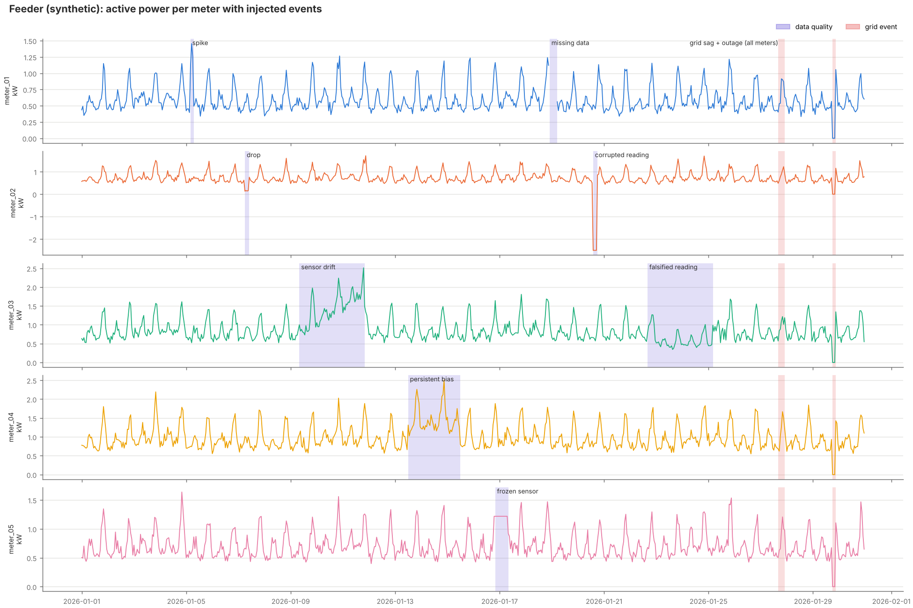
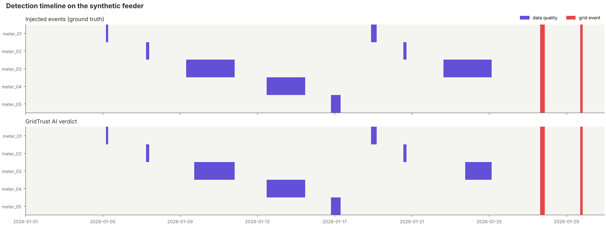
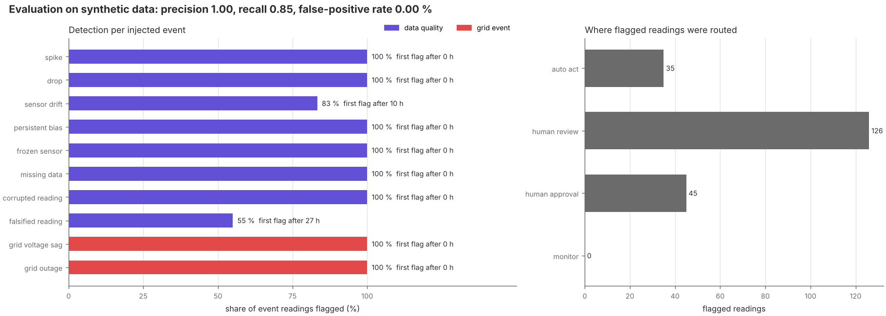

# GridTrust AI

**Energy anomaly detection and trust layer** · TSYP14 Technical Challenge · *EnergyMind Tunisia*

GridTrust AI sits between raw smart-meter data and automated action. For every reading it
decides whether the data can be trusted, explains why in plain language, and decides
whether the AI may act alone or a human operator must decide.

Phase 1 is a working single-node prototype on a **synthetic smart-metered feeder**
(5 meters, hourly, 30 days) with 10 labelled, reproducible injected events.

> All data and results in this repository are **synthetic**. They demonstrate the method;
> they do not establish real-world grid performance.

## The core idea

A single meter behaving oddly is most likely a **data-quality problem**. Several independent
meters on the same feeder changing at the same time is most likely a **genuine grid event**.
These need opposite responses: a bad sensor can be quarantined automatically, while a real
grid event must reach a human quickly and must never be "corrected" away.

```
readings ─► validation rules ─────────┐
            physics check (P ≈ V·I) ──┤
            meter's own usual pattern ┼─► verdict + confidence + explanation ─► escalation policy ─► decision log
            Isolation Forest ─────────┤        (data quality │ grid event)          (auto │ review │ approval)
            feeder cross-check ───────┘
```

## Phase 1 results (synthetic)

| Metric (challenge brief) | Seed 42 | 5 held-out seeds (mean) |
|---|---|---|
| Detection precision | 1.00 | 1.00 |
| Detection recall (readings) | 0.85 | 0.85 |
| False-positive rate | 0.00 % | 0.01 % |
| Events detected | 10 / 10 | 10 / 10 in every run |
| Grid event vs data-quality, correct | 100 % | 100 % |
| Flagged readings with a plain-language explanation | 100 % | 100 % |
| Processing latency | ≈ 0.25 ms per reading | — |

Thresholds were set while looking at seed 42, so seed 42 is optimistic. The held-out seeds
use the same event types with fresh noise; a real held-out test on measured data is a
Phase 2 task. Full numbers: [`results/metrics.json`](results/metrics.json).

**Where it is weak, honestly:** slow faults are detected late. Sensor drift is first
flagged after about 10 h (83 % of its readings), and careful falsification, where power
and current are lowered together so the physics check still passes, after about 27 h
(55 %). These are the main targets for Phase 2.





## How the four challenge goals are covered

| Goal | Phase 1 implementation | File |
|---|---|---|
| 1. Anomaly and bias detection | Validation rules (missing, implausible, frozen), physics consistency check P ≈ V·I (catches bias, drift, spikes and drops on the power channel), deviation from each meter's own robust daily profile (catches falsification), Isolation Forest, and a feeder cross-check that separates grid events from data problems | `src/detect_anomalies.py` |
| 2. Confidence and explainability | Every flagged reading has a verdict, a heuristic confidence score (combined evidence, *not* a calibrated probability), one sentence per piece of evidence and the model's main driver feature. Incidents go to an auditable JSON Lines decision log with model and policy versions | `results/decision_log.jsonl` |
| 3. Human-AI escalation and governance | Explicit, versioned thresholds: the AI may act alone only on data (quarantine, substitute estimate, mark sensor suspect). Grid events always need human approval; suspected falsification always goes to a human; an over-trust guard sends a meter to a human after repeated automatic corrections | `src/escalation.py`, [`docs/ESCALATION_POLICY.md`](docs/ESCALATION_POLICY.md) |
| 4. Shared learning across the noosphere | Documented protocol: nodes share pattern signatures and calibration summaries, never raw readings | [`docs/SHARED_LEARNING_DESIGN.md`](docs/SHARED_LEARNING_DESIGN.md) |

## Injected events

| ID | Type | Category | Meters | How it is generated |
|---|---|---|---|---|
| EV01 | spike | data quality | meter_01 | power reading ×2.6, V and I unchanged |
| EV02 | drop | data quality | meter_02 | power reading ×0.2 |
| EV03 | sensor drift | data quality | meter_03 | power + linear offset 0 → 1.0 kW over 60 h |
| EV04 | persistent bias | data quality | meter_04 | power ×1.25 + 0.3 kW |
| EV05 | frozen sensor | data quality | meter_05 | all channels repeat the last value |
| EV06 | missing data | data quality | meter_01 | all channels missing |
| EV07 | corrupted reading | data quality | meter_02 | P = −2.5 kW, V = 0 V, I = 655.35 A |
| EV08 | falsified reading | data quality | meter_03 | P and I lowered together to 60 % (consistent tampering) |
| EV09 | voltage sag | grid event | all 5 | V −22 V, P ×0.9, I follows physics |
| EV10 | outage | grid event | all 5 | P, V, I = 0 |

Generation uses a fixed seed (42). Labels are stored per reading
(`data/simulated_energy_readings.csv`) and per event (`data/injected_events.csv`).
See [`data/DATASET_NOTE.md`](data/DATASET_NOTE.md).

## Run it

Requires Python 3.10+.

```bash
python -m pip install -r requirements.txt
python src/generate_dataset.py     # synthetic feeder + labels + dataset figure
python src/detect_anomalies.py     # verdicts, routes, decision log
python src/evaluate.py             # metrics.json + timeline and evaluation figures
python -m unittest discover -s tests -v
```

### Run on real measured power (UCI ElectricityLoadDiagrams20112014)

The same pipeline runs on real consumption data. Download the dataset from
<https://archive.ics.uci.edu/dataset/321/electricityloaddiagrams20112014> (a .zip of about
250 MB containing `LD2011_2014.txt`), then:

```bash
python src/generate_dataset.py --uci path/to/LD2011_2014.txt.zip   # or the extracted .txt
python src/detect_anomalies.py --uci
python src/evaluate.py --uci path/to/LD2011_2014.txt.zip
```

`src/load_uci.py` picks 5 household-scale clients that are active for the whole 30-day
window (default from 6 January 2014, change with `--start YYYY-MM-DD`), averages their
15-minute kW to hourly, and injects the same 10 labelled events. The dataset has no voltage or
current, so those are simulated from the real power and the rows are marked as such.
Outputs go to `data/uci_*.csv`, `results/uci/` and `figures/*_uci.png`; the chosen clients
are listed in `data/uci_client_selection.csv`.

## Data sources

| Dataset | Used for | Link |
|---|---|---|
| Synthetic feeder (this repo) | Phase 1 results: 5 meters, 10 labelled injected events | `src/generate_dataset.py`, [`data/`](data/) |
| UCI ElectricityLoadDiagrams20112014 | Real measured power baseline (`--uci`): 370 clients, 15-minute kW, 2011–2014, CC BY 4.0 | <https://archive.ics.uci.edu/dataset/321/electricityloaddiagrams20112014> |
| UCI Individual Household Electric Power Consumption | Phase 2: test the physics check on measured voltage and current (one household, 1-minute, 2006–2010, CC BY 4.0) | <https://archive.ics.uci.edu/ml/datasets/individual+household+electric+power+consumption> |
| STEG open data (Tunisia) | Phase 2, if suitable: adapt load profiles to Tunisian patterns | <https://catalog.data.gov.tn/fr/producteurs-de-donnees/steg-tn> |

Downloaded datasets are never committed; `.gitignore` blocks the raw files.

## Repository layout

```
data/        synthetic readings, event labels, dataset note
src/         generator, detection pipeline, escalation policy, evaluation
results/     per-reading results, decision log, metrics
figures/     dataset, timeline and evaluation figures
docs/        escalation policy, shared-learning design, Phase 2 roadmap
tests/       dataset and pipeline tests
```

## Limitations

- Synthetic baseline and synthetic events; no measured grid data yet.
- Voltage and current are simulated from power, so the physics check is easier here than on real meters.
- The confidence score is a combined-evidence heuristic, not a calibrated probability.
- Hourly data: detection delays are measured in hours.
- No physical equipment is connected and no control command is ever issued.
- Multi-node sharing is a documented design only.

Next steps are in [`docs/PHASE2_ROADMAP.md`](docs/PHASE2_ROADMAP.md).
